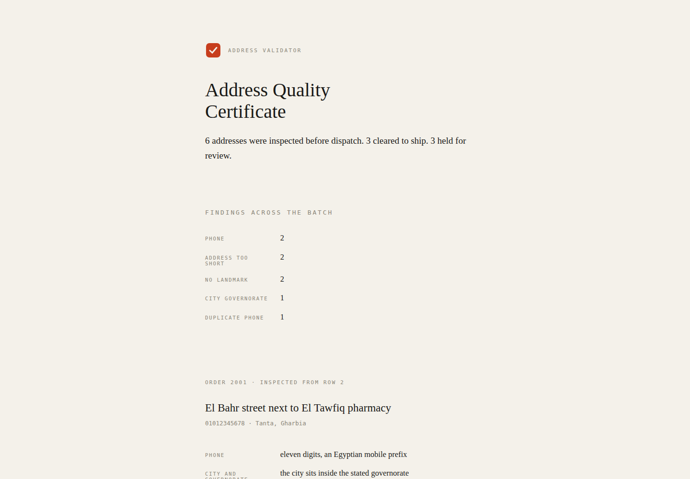

# Address Validator + Confirmation Classifier

The cheapest failed delivery is the one you never ship.

This checker runs on a COD order before dispatch and flags the problems that
turn into "customer not reachable" on the courier's sheet:

- Phone numbers that are too short, landlines dressed as mobiles, or wrong prefixes
- A city that does not belong to the stated governorate
- Addresses with no landmark. In Egypt a courier navigates by "next to the
  pharmacy", not by street names, and an address without one is a phone call
  that fails

It also classifies the customer's WhatsApp confirmation reply into four
buckets: `confirmed`, `postpone`, `refused`, `needs_human`. Only confirmed
orders ship the same day. Silence is not a confirmation, it goes to
needs_human. The interface, the reports and this document are English; the
classifier itself still recognises the Arabic confirmations Egyptian
customers actually type, because that is input, not interface.

## Run it

```bash
python3 validator.py
```

Runs three demo orders and five demo replies, no setup, no dependencies.

## Batch mode

Give it a CSV and it validates the whole dispatch list at once:

```bash
python3 validator.py sample_orders.csv
python3 validator.py sample_orders.csv --json results.json --report report.html
python3 validator.py sample_orders.csv --strict
```

Expected columns: `order_id, phone, governorate, city, address`, plus an optional `reply` column whose text gets classified per order. The batch report splits orders into ship and no-ship and lists every issue per order.

Batch input is hardened the same way a dispatch list deserves:

- Missing required columns stop the run with a clear error
- Rows with an empty order id or phone, or the wrong number of fields, are reported as malformed with their row number and reason, in the output and in the JSON
- A repeated order id is reported and skipped, so one order never ships twice on paper
- A phone number that appears on two orders is reported, and the later order is blocked until a human looks at it
- `--strict` exits with code 2 when malformed or duplicate rows were found
- `--report` writes a standalone HTML certificate: one quiet sheet per order — the address as inspected, the checks as short findings, and the verdict delivered as a single vermillion stamp (CLEARED TO SHIP or NEEDS REVIEW). No charts, no dashboard; validation is a judgment, so the report reads like one

The bundled `sample_orders.csv` is fictional and shows all of this: six orders including one repeated phone.

## Configuration and logging

Batch runs log to a file:

| Variable | Default | Meaning |
|---|---|---|
| `VALIDATOR_LOG_FILE` | `validator.log` | Log file path (`--log` overrides it) |
| `VALIDATOR_MIN_ADDRESS_LEN` | `12` | Addresses shorter than this are flagged as too short |

## Tests

```bash
python3 tests/test_validator.py
```

Twenty six checks covering the phone, address and reply logic, batch duplicates (order id and phone), malformed rows, the JSON and HTML reports, the log file, strict mode, and the original demo mode.

## What this is (and is not)

This is the decision logic, in the open. The production version connects it
to the WhatsApp Business API and a store's order feed. The logic is the part
that matters, the plumbing is commodity.

## Screenshots



The report the validator issues: six addresses inspected on the sample
file, three cleared to ship, three held for review. All data on this
screen is the fictional sample data shipped with the tool.
